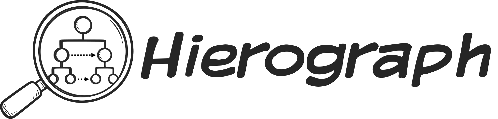

<p align="center">
  
</p>

---

**Hierograph makes the architecture of a JVM codebase visible, to you and to your AI
agent.** It models your Java or Kotlin project as a hierarchy (modules, packages, types,
members) and rolls every dependency up to any level of it. You see how the parts depend
on each other, where they form cycles, and what a restructuring would do before you
touch the code. The model follows your build as you work.

Hierograph is an [MCP](https://modelcontextprotocol.io) server. Any MCP-capable agent
can use it: Claude, Cursor, Codex, or your own.

Hierograph is for engineers who work on large, long-lived JVM systems with Maven or
Gradle builds and who need to reason about structure, coupling and layering, not just
trace one call chain.

---

## What you can do with it

### See the structure

Ask your agent for a picture, and it renders one from the live model:

- **Dependency structure matrix (DSM):** every dependency among a set of modules or
  packages in one matrix, in dependency order. In a cycle, the order puts the least
  possible weight against the layering, and those dependencies are named as the ones
  to cut.
- **Layered dependency graph:** an interactive page with the core at the bottom and
  every arrow pointing down. Click a node to trace what it uses and what uses it;
  search, thin out light edges, or hide the test modules.
- **Levelized structure map:** modules and packages as nested, collapsible boxes in
  rows by level. Package tangles are boxed in red, and only the dependencies that run
  against the levels are drawn as arrows.

The layered graph and the structure map are self-contained HTML pages that you keep,
open in a browser and share.

### Try a restructuring before you make it

A **view** looks at the system through a grouping of your own: by layer, bounded
context, team, or target architecture. Every tool answers in a view, so "is it
layered?" becomes a question about *your* layers.

A **restructuring view** goes further. It moves packages and types into other or new
modules, virtually. Hierograph projects the result: the new modules' dependencies and
every cycle the move would create, before any code changes. Planning an extraction
becomes a series of cheap experiments instead of a branch you throw away.

Project views live in the repository (`.hierograph-views/`) and are versioned with the
code.

### Ask architectural questions at any level

- *How coupled are these two modules, and is it deep or broad?* A weight, broken down by
  kind: calls, inheritance, field types, annotations.
- *Why does module A depend on module B?* Every type pair behind the edge, down to the
  individual references and their source lines.
- *Does the domain layer depend on infrastructure?* Yes or no, with the edges that say
  so.
- *If I change this class, what breaks?* Everything it affects transitively, and the
  dependency chain that connects any two of them.

### Explore it in the browser

The server also serves a web UI, at `http://localhost:8765/ui/`. It's the companion to
your agent session, not a replacement: the agent stays where you ask questions, and it
opens the UI with links into a given state when a picture says more than a terminal.
For now the UI has a start screen: the workspace, the graph, the hierarchy views, and the
server with its JVM's metrics, live.

### Always current

Hierograph doesn't take a snapshot and go stale. It watches the compiled output of your
build: recompile a class in your IDE, and the model follows within seconds. Added or
removed modules reach it too. After an edit to a build file, the server can regenerate the
manifest itself, except for a Gradle build served from Docker, where you rerun one
command on the host.

---

## How it works

```
Your build (IDE, Maven, Gradle) ── compiles ──► class files
                                                    │  read-only
                                                    ▼
                            Hierograph server: bytecode scanner (ASM)
                            → hierarchical model in memory + detail snapshot
                            → watches the build and rescans what changed
                                                    │  MCP (HTTP, localhost)
                                                    ▼
                            Your AI agent, with the Hierograph skills
```

**Bytecode, not text.** Hierograph reads compiled class files with its own ASM-based
scanner. Where a syntactic parser sees `foo.bar()` and records a call to *some* `bar`,
the scanner knows *which* `bar`, on which resolved type, reached through which
inheritance path, across library dependencies and generics. The dependencies are
resolved facts, not textual guesses. Hierograph never compiles; your build does.

**The build manifest.** What only the build knows (the modules, their output
directories, their resolved classpaths) comes from a small manifest written by the
Hierograph Maven or Gradle plugin. In the Docker image, a Maven manifest is generated
inside the container, so the project needs no change at all.

**In memory.** The hierarchy and every type-level dependency stay in memory, so
aggregation, impact and reachability queries answer at any level without a database
round trip. Member-level detail is kept in a Parquet snapshot beside it. There's no
graph database to run, and nothing leaves your machine: the server listens on
`localhost` only.

**Skills.** The MCP tools answer questions; the skills turn them into results. They are
plain `SKILL.md` instructions for an agent:

| Skill | Does |
|-------|------|
| `hierograph-bootstrap` | Sets a project up: starts the server, produces the manifest, registers the server with your agent. |
| `hierograph-structure` | DSM, layered graph, levelized structure map, layering and cycle analysis, also in a view. |
| `hierograph-extract` | Plans a module or package extraction as a restructuring view and checks it for hidden dependencies. |

---

## Get started

### Before you begin

- A Maven (3.9 or later) or Gradle (8.11 or later) project that builds.
- Docker, or Java 21 or later to run the server as a local process.
- An MCP-capable agent.

### Set up with a skill

If your agent supports `SKILL.md` skills, let the bootstrap skill do the setup. It
checks your project, starts the server and registers it.

- **Claude Code:** install the plugin from this repository's marketplace, then run the
  bootstrap skill in your project. See the [plugin's README](plugins/hierograph/README.md).
- **Other agents:** copy the skill folders from
  [`plugins/hierograph/skills`](plugins/hierograph/skills) to where your agent loads
  skills from, then ask it to set up Hierograph for your project.

### Set up by hand

For a Maven project, start the container from your project's root directory:

```bash
docker run -d --name hierograph-mcp -p 127.0.0.1:8765:8765 \
  -e HIEROGRAPH_URL=http://localhost:8765/mcp \
  -e HIEROGRAPH_WORKSPACE=PROJECT_DIR \
  -v PROJECT_DIR:/workspace:ro \
  -v HOME_DIR/.m2:/m2:ro \
  -v hierograph-PROJECT_NAME:/hierograph \
  ghcr.io/code-kontor/hierograph-mcp-server:VERSION
```

Replace the following:

- `PROJECT_DIR`: the absolute path of the directory that holds the root `pom.xml`.
- `HOME_DIR`: your home directory, so the container can use your local Maven
  repository.
- `PROJECT_NAME`: a name for the volume that keeps the server's state across restarts.
- `VERSION`: the latest Hierograph release.

The project and your Maven repository are mounted read-only. The container generates
the manifest, scans the project and serves it on `http://localhost:8765/mcp`.

Then register the server with your agent. Most agents take a JSON entry like this:

```json
{
  "mcpServers": {
    "hierograph": { "type": "http", "url": "http://localhost:8765/mcp" }
  }
}
```

For a Gradle build, or to run the server as a local Java process, follow the steps of
the [bootstrap skill](plugins/hierograph/skills/hierograph-bootstrap/SKILL.md); it is a
readable step-by-step guide for people as well as agents.

### Your first questions

Ask your agent:

- *"Give me an overview of this codebase's modules."*
- *"Draw the layered dependency graph of the modules."*
- *"Are there package cycles in `MODULE`? Show me a levelized structure map."*
- *"What if I moved `PACKAGE` into a new module? Would that create a cycle?"*

---

## The tools

The server offers 19 MCP tools in six groups:

| Group | Tools |
|-------|-------|
| Orientation and navigation | `graph_overview`, `find_node`, `list_children`, `list_descendants` |
| Dependencies | `aggregated_dependencies`, `pairwise_dependencies`, `outgoing_dependencies`, `incoming_dependencies` |
| Reachability | `affected_by`, `find_dependency_path` |
| Entity detail | `type_details`, `method_details`, `field_details` |
| Views | `define_view`, `list_views`, `get_view`, `delete_view` |
| Maintenance | `reload_graph`, `server_info` |

Every tool that reads the graph takes an optional `view`. Large results are paged, and every page stays
within a fixed response budget. See the
[MCP tools specification](hierograph-server/io.hierograph.server/spec/hierograph-mcp-tools.md).

---

## Built for the JVM

Hierograph goes deep on the JVM rather than wide across many languages. The things a
generalist treats as edge cases (resolved generic types, deep inheritance hierarchies,
annotation-driven wiring) are what Hierograph reads straight from the bytecode.

Its core is scanner-agnostic: the hierarchical model is built from resolved structural
facts, and the bytecode scanner provides them for the JVM. Other languages could plug
in through scanners of their own.

**What bytecode can't show.** A compile-time constant is copied into the class that
uses it, so a use of a `static final` constant leaves no reference behind. Reflection
and string-based wiring don't appear as dependencies either.

---

## Documentation

- [MCP tools](hierograph-server/io.hierograph.server/spec/hierograph-mcp-tools.md):
  every tool, its parameters and guarantees
- [Views](hierograph-server/io.hierograph.server.views/spec/hierograph-views.md): the
  view document, grouping and restructuring
- [Maven plugin](hierograph-build-support/hierograph-maven-plugin/spec/hierograph-maven-plugin.md)
  and [Gradle plugin](hierograph-build-support/hierograph-gradle-plugin/spec/hierograph-gradle-plugin.md):
  the build manifest
- [Bytecode scanner](hierograph-graphstore/io.hierograph.graphstore.jvm.scanner/spec/hierograph-graphstore-scanner.md),
  [GraphStore](hierograph-graphstore/io.hierograph.graphstore.jvm.store/spec/hierograph-graphstore.md)
  and [hierarchical graph model](hierograph-hierarchicalgraph/io.hierograph.hierarchicalgraph.model/spec/hierarchicalgraph-model.md):
  how the model is built

## Contributing

How commits are written and features are named: [CONTRIBUTING.md](CONTRIBUTING.md). How
to build: [BUILD.md](BUILD.md).

## License

Hierograph is open source under the [Apache License, Version 2.0](LICENSE). Copyright
2026 Gerd Wuetherich.
